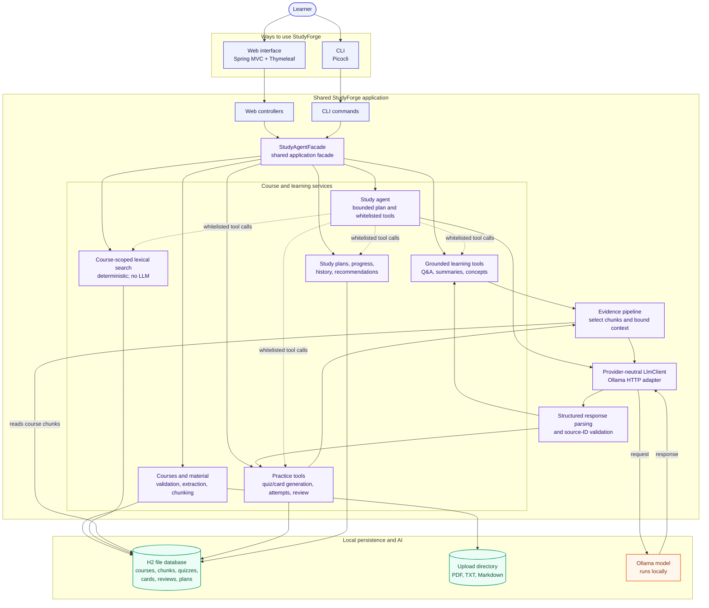

# StudyForge AI

StudyForge AI is an adaptive study and learning agent for the EECS3311 Fall 2026 course project. It combines deterministic course-learning software with a provider-neutral, grounded AI layer and a bounded multi-step study agent.

## Prerequisites

- Java 21
- Maven 3.9+

No Node/npm, Docker, or external database server is required.

## Build and test

```text
mvn clean test
```

The test profile uses isolated in-memory H2. Development data uses file-based H2 under `./data/coursepilot` and uploaded files under `./data/uploads`; both are excluded from Git.

## Run the web application

```text
mvn spring-boot:run
```

Open `http://localhost:8080/`. Create or open a course to see its evidence-backed next step, learning summary, and study tools. **Open Study Studio** opens the first ready document in the split reader-and-tutor workspace; if no ready document exists, it takes you to the course library to upload one. Use **Materials library** to upload PDF, TXT, or Markdown files. The application validates the extension, size, and content, calculates SHA-256, rejects same-course duplicates, stores a generated safe filename, extracts UTF-8/PDF text, normalizes it, chunks it, and persists document metadata and chunks.

The Materials page also provides deterministic lexical search scoped to the current course. Search combines exact-phrase matching, term coverage, bounded term frequency, and a modest filename boost. It is not semantic search and does not use an LLM, embeddings, or a vector database.

Configuration defaults:

- `coursepilot.storage.upload-dir=./data/uploads`
- `coursepilot.storage.max-file-size=10485760` (10 MB)
- `coursepilot.retrieval.chunk-size=1200`
- `coursepilot.retrieval.chunk-overlap=150`

Text-based PDFs are supported. OCR is not implemented, so image-only/scanned PDFs may be rejected when no extractable text is present.

## Run the CLI

The CLI uses a separate non-web Spring entry point while sharing `StudyAgentFacade` and `CourseService` with the web application:

PowerShell example (quote the `-D` argument so PowerShell passes it intact):

```powershell
mvn -q dependency:build-classpath '-Dmdep.outputFile=target\cp.txt'
$cp = (Resolve-Path target\classes).Path + ';' + (Get-Content -Raw target\cp.txt).Trim()
java -cp $cp ca.yorku.eecs3311.coursepilot.cli.CoursePilotCliApplication course list
java -cp $cp ca.yorku.eecs3311.coursepilot.cli.CoursePilotCliApplication course create --code EECS3311 --name "Software Design"
java -cp $cp ca.yorku.eecs3311.coursepilot.cli.CoursePilotCliApplication course show --course EECS3311
```

The CLI and web application share the same `StudyAgentFacade`, service layer, and file-based H2 data.

Material commands use the course code and share the same import service:

```powershell
java -cp $cp ca.yorku.eecs3311.coursepilot.cli.CoursePilotCliApplication material add --course EECS3311 --file .\notes.md
java -cp $cp ca.yorku.eecs3311.coursepilot.cli.CoursePilotCliApplication material list --course EECS3311
java -cp $cp ca.yorku.eecs3311.coursepilot.cli.CoursePilotCliApplication material show --course EECS3311 --id 1
java -cp $cp ca.yorku.eecs3311.coursepilot.cli.CoursePilotCliApplication material search --course EECS3311 --query "strategy pattern" --limit 5
```

Search defaults to 5 results and accepts a maximum of 20. Queries with no relevant material return a friendly empty result. Search results preserve document name, chunk index, and PDF page metadata where available.

## AI foundation and grounded learning

The provider-neutral AI foundation now supports grounded Q&A, document/topic summaries, concept extraction, flashcards, quizzes, short-answer grading, wrong-answer explanations, and bounded agent assistance. Ollama and Gemini are accessed through `LlmClient` adapters using Java's HTTP client and Jackson. Provider availability is checked only when requested and all calls use bounded timeouts.

Configuration is overrideable with Spring properties. The recommended local model is `qwen3:4b`, which uses substantially less memory and is faster for grounded quiz, flashcard, summary, and concept generation on typical student hardware. `qwen-claude-14b:latest` remains available as a quality fallback if the smaller model produces weaker results:

```properties
coursepilot.ai.enabled=true
coursepilot.ai.provider=ollama
coursepilot.ai.base-url=http://localhost:11434
coursepilot.ai.model=qwen3:4b
coursepilot.ai.connect-timeout=2s
coursepilot.ai.request-timeout=180s
```

Switch models from **AI status** for the current running session, or change `COURSEPILOT_AI_MODEL` in `.env` for the persistent choice after restart. The status page only offers explicitly supported models for the selected provider. Both Ollama models run locally; Gemini sends bounded retrieved excerpts to Google's hosted API.

Quiz generation uses bounded three-question batches and a smaller grounded context so larger requests such as 20 questions do not get truncated as one oversized model response.

Use `studyforge ai status` to inspect availability. Ask a grounded question from `/courses/{id}/ask` or with `studyforge ask --course EECS3311 --question "..."`. Each question retrieves only that course's relevant material first, bounds the context, requires structured JSON, and validates returned source IDs. If Ollama is stopped, the application still starts and deterministic course/material/search features remain available.

To use Gemini, put the key in the ignored project-root `.env` file and add:

```env
COURSEPILOT_AI_PROVIDER=gemini
COURSEPILOT_AI_BASE_URL=https://generativelanguage.googleapis.com
COURSEPILOT_AI_MODEL=gemini-3.5-flash-lite
GEMINI_API_KEY=your_key_here
```

StudyForge loads `.env` for local development without printing its values. Real environment variables take precedence. Gemini sends bounded retrieved course excerpts to Google's hosted API, so use Ollama for material that must remain local. Gemini free-tier availability and quotas vary by account and model; rate limits can produce an actionable unavailable status.

The web workflow is course-first: open a course, use the three-step workspace to upload material, search it, and then ask StudyForge. The sidebar labels implemented tools separately from planned features, and unavailable AI/material states include recovery actions.

To ask questions about one specific uploaded document, open its **View details** link from the course library. PDFs open in a split document workspace with an inline preview and **Ask this PDF** panel. Document Q&amp;A uses only that document's retrieved chunks; course-wide Q&amp;A remains available from the course workspace.

## Project structure

- `src/main/java/ca/yorku/eecs3311/coursepilot/` - layered application code
- `src/main/resources/templates/` - Thymeleaf GUI
- `src/main/resources/static/` - custom CSS
- `src/test/` - deterministic and MVC tests
- `docs/` - approved Stage 1 design and Stage 2 traceability artifacts

## How the project works

The web application and CLI share the same application facade and services. Material is validated, extracted, and chunked before it is used by deterministic search or grounded AI study tools. Persistent course and study data stays in local H2 and uploaded files stay in the local data directory.



## Current limitations

Summarization and concept quality depends on the configured model; lexical retrieval is not semantic search, grounding reduces but cannot eliminate hallucination risk, and OCR remains future backlog work for image-only PDFs. No embeddings or vector database is used. The agent uses bounded observable plans and whitelisted tools; it does not execute shell, filesystem, SQL, or arbitrary HTTP actions.

## Summaries and concepts

From a ready document workspace, choose **Summarize** or **Extract concepts**. Document summaries use only that document's persisted chunks and display the source document/chunk/page metadata used. Topic summaries are available from the course Materials page; they run deterministic course-scoped lexical search first and do not call the model when no relevant evidence exists. The Concepts navigation page lets you choose a ready document.

Summaries return a structured overview and key points. Concepts return structured names, definitions, and sources; duplicate names are merged deterministically. Model-returned source IDs are validated against StudyForge-owned sources, and unready documents, malformed responses, provider outages, and invalid references produce controlled errors. Context is bounded at 12,000 characters by default, with source order preserved. Results are request-based and are not persisted yet.

CLI examples:

```powershell
java -cp $cp ca.yorku.eecs3311.coursepilot.cli.CoursePilotCliApplication summary document --course EECS3311 --document 6
java -cp $cp ca.yorku.eecs3311.coursepilot.cli.CoursePilotCliApplication summary topic --course EECS3311 --topic "SOLID principles"
java -cp $cp ca.yorku.eecs3311.coursepilot.cli.CoursePilotCliApplication concepts extract --course EECS3311 --document 6
```

## Flashcards and review

Open **Flashcards** from a course workspace, choose a READY document, and request 5–20 cards. Generation uses only persisted chunks from that document, validates structured output and source IDs, removes duplicate questions deterministically, and persists valid cards with document/chunk/page provenance. Existing cards remain reviewable when Ollama is offline.

Review cards at `/courses/{courseId}/flashcards/review`: reveal the answer, then rate each card **Incorrect**, **Hard**, **Good**, or **Easy**. Every rating is stored as an append-only review event; no AI call, spaced repetition, or progress analysis is used for review.

```powershell
java -cp $cp ca.yorku.eecs3311.coursepilot.cli.CoursePilotCliApplication flashcards generate --course EECS3311 --document 6 --count 10
java -cp $cp ca.yorku.eecs3311.coursepilot.cli.CoursePilotCliApplication flashcards list --course EECS3311
java -cp $cp ca.yorku.eecs3311.coursepilot.cli.CoursePilotCliApplication flashcards review --course EECS3311 --card 1 --rating GOOD
```

## F08–F14 and agent assistance

The course workspace now includes Quizzes, Progress, Study Plan, Next step, History, and Agent assistance. Quiz generation is grounded in a selected READY document; objective answers are graded deterministically, while short-answer grading and wrong-answer explanations use the provider-neutral `LlmClient` with controlled offline behavior. Progress uses transparent thresholds: below 60 is `WEAK`, 60–79.9 is `DEVELOPING`, and 80 or above is `STRONG`.

Study plans are persisted and use the Strategy pattern with Balanced, Weak Topic Focused, and Exam Cram strategies. History is course-scoped and derived from persisted reviews, quiz attempts, and plans. The agent accepts a higher-level study request, validates a bounded observable plan, executes only whitelisted course tools, and synthesizes a safe response.

```powershell
java -cp $cp ca.yorku.eecs3311.coursepilot.cli.CoursePilotCliApplication quiz list --course EECS3311
java -cp $cp ca.yorku.eecs3311.coursepilot.cli.CoursePilotCliApplication progress --course EECS3311
java -cp $cp ca.yorku.eecs3311.coursepilot.cli.CoursePilotCliApplication study-plan list --course EECS3311
java -cp $cp ca.yorku.eecs3311.coursepilot.cli.CoursePilotCliApplication history --course EECS3311
java -cp $cp ca.yorku.eecs3311.coursepilot.cli.CoursePilotCliApplication recommend --course EECS3311
java -cp $cp ca.yorku.eecs3311.coursepilot.cli.CoursePilotCliApplication agent --course EECS3311 --request "Help me study what I am weakest at"
```
