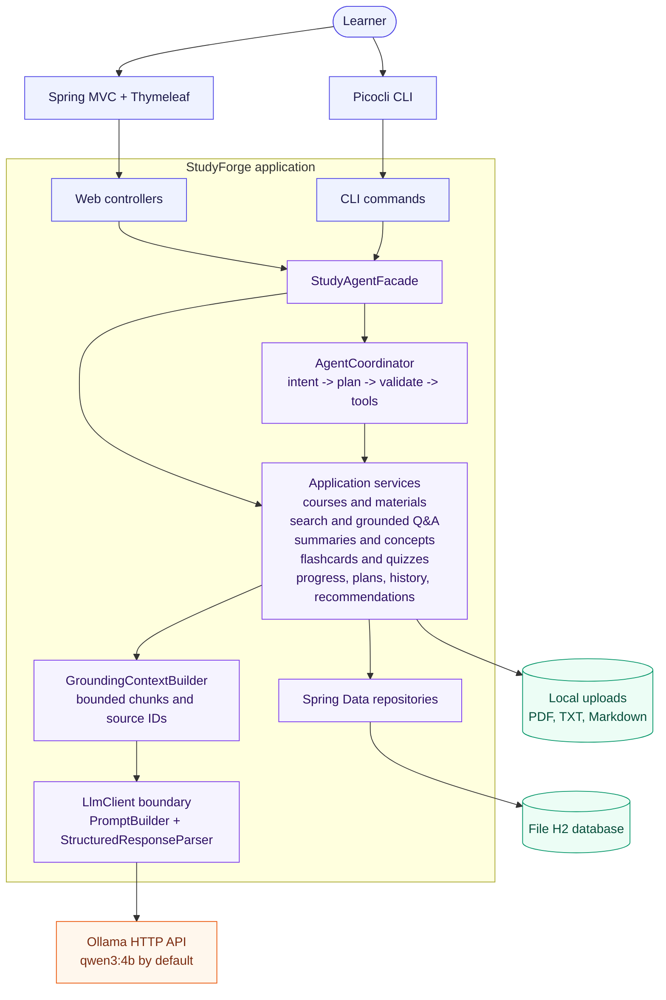

# StudyForge

StudyForge is an implemented local-first study-support prototype created for an EECS 3311 course project. It combines a Spring MVC + Thymeleaf GUI, a Picocli CLI, deterministic course/material/search workflows, grounded learning tools, and bounded Ollama-based AI features.

## Current focus

- Using locally hosted language models to support grounded study workflows.
- Keeping retrieval, validation, persistence, and AI provider boundaries explicit.
- Continuing to refine the implemented prototype with automated and manual verification.

## Why this project matters

StudyForge reflects an interest in building practical AI tools with clear boundaries, understandable architecture, and a useful end-user purpose. The design-first workflow helps connect user needs, technical decisions, and future implementation work.

## Repository contents

- [Stage 1 design proposal](docs/StudyForge_Stage_1_Design_Proposal.pdf)
- [Implemented architecture](docs/architecture-diagram.md)
- Spring Boot application source, tests, and UI resources

## Project status

This is an active course project. The repository contains the design proposal, implemented prototype, architecture documentation, and verification artifacts.

## Author

Zaaid Ahmed — [GitHub](https://github.com/ZaaidAhmed) · [Portfolio](https://zaaidahmed.netlify.app/)

## Implemented architecture

The implemented system is a local-first Spring Boot modular monolith. The browser GUI and Picocli CLI share the same application facade and services; they do not implement separate business rules.

### Runtime workflow

1. A course is selected, then a PDF, TXT, or Markdown document is validated and stored with a generated safe filename.
2. Text is extracted, normalized, split into overlapping chunks, and persisted with page/chunk metadata.
3. Deterministic lexical retrieval selects course- or document-scoped evidence.
4. `GroundingContextBuilder` bounds the context and assigns StudyForge-owned source IDs.
5. `PromptBuilder` creates a source-only structured request for the provider-neutral `LlmClient`.
6. `OllamaLlmAdapter` calls the local model. `StructuredResponseParser` validates JSON, required fields, and source references before display or persistence.
7. Learning activity is stored in local H2 and reused by progress, history, recommendations, and bounded agent tools.

### Actual implementation boundaries

- Web entry points: `coursepilot.web` controllers and Thymeleaf templates.
- CLI entry points: `coursepilot.cli` Picocli commands.
- Shared facade: `coursepilot.application.StudyAgentFacade`.
- Business workflows: `coursepilot.application.service`.
- Agent orchestration: `coursepilot.application.agent` with whitelisted course-scoped tools.
- Domain and persistence: `coursepilot.domain.model` and `coursepilot.domain.repository`.
- Document pipeline: `coursepilot.infrastructure.document`.
- AI provider: `coursepilot.infrastructure.ai.OllamaLlmAdapter` behind `LlmClient`.

