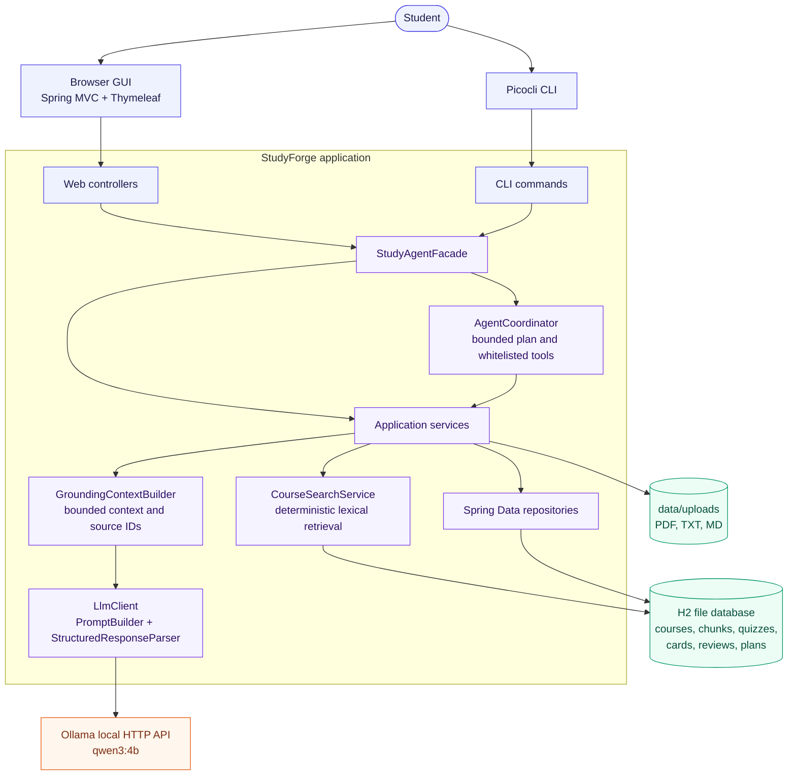

# StudyForge implemented architecture

StudyForge is a local-first Spring Boot modular monolith. The diagram below describes the architecture that is implemented in the source repository, not a future design.

## Evidence and AI flow

Model output is untrusted. It is not displayed or persisted until structured parsing and StudyForge-owned source validation succeed. AI failures are recoverable; deterministic search and other local workflows remain usable when Ollama is unavailable.

## Implemented package map

| Layer | Actual package | Responsibility |
|---|---|---|
| Web | `ca.yorku.eecs3311.coursepilot.web` | GUI routes, form handling, recovery states |
| CLI | `ca.yorku.eecs3311.coursepilot.cli` | Picocli commands and exit codes |
| Facade | `ca.yorku.eecs3311.coursepilot.application` | Shared entry point for GUI and CLI |
| Services | `ca.yorku.eecs3311.coursepilot.application.service` | Course, material, search, AI and learning workflows |
| Agent | `ca.yorku.eecs3311.coursepilot.application.agent` | Intent analysis, bounded plans, tools and memory |
| AI | `ca.yorku.eecs3311.coursepilot.application.ai` | Requests, prompts, response contracts and parsing |
| Infrastructure | `ca.yorku.eecs3311.coursepilot.infrastructure` | Ollama and document storage/extraction |
| Domain | `ca.yorku.eecs3311.coursepilot.domain` | Entities, value rules and repositories |

## Deliberate limitations

The current implementation does not use embeddings, a vector database, OCR, authentication, cloud AI, microservices, or arbitrary agent shell/filesystem/HTTP access. Ollama is local and optional; the default model is configurable with `coursepilot.ai.model`.
