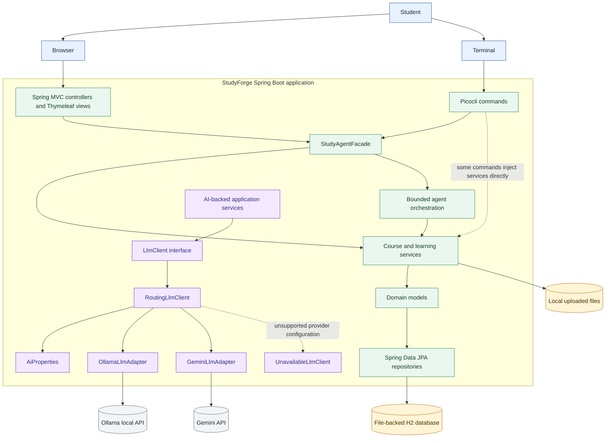
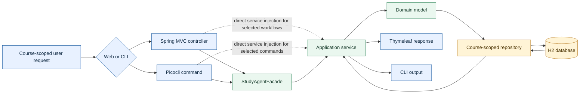
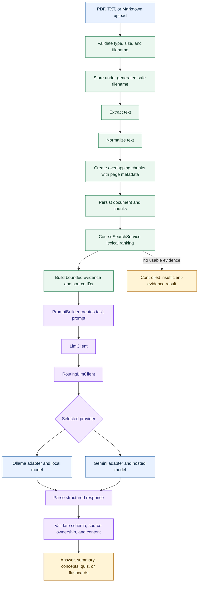
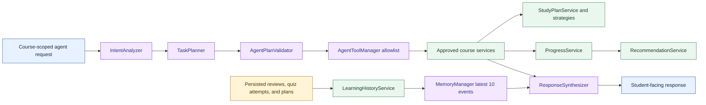

# StudyForge AI Architecture

This document describes the architecture implemented in the current StudyForge source. StudyForge is a Spring Boot modular monolith: the web application and Picocli CLI share application services, domain models, persistence, and provider integrations. The diagrams show the main runtime paths; optional AI calls are separated from deterministic workflows.

## 1. System architecture

The application keeps presentation, use-case orchestration, provider adapters, and persistence in one deployable process. Web controllers and CLI commands translate user input to shared application behavior; a small number of CLI commands use application services directly.

## 2. Request and persistence flow

Course, document, quiz, flashcard, attempt, review, and study-plan operations are validated in application services and queried through course-scoped repositories. The database is stored at `./data/coursepilot`; uploaded source files are stored separately under `./data/uploads`.

## 3. Material, retrieval, and AI flow

Retrieval is deterministic lexical search over the selected course's ready document chunks. AI-backed features receive bounded evidence; parsed outputs and cited source IDs are validated before results are displayed or saved. If AI is unavailable, deterministic workflows such as search, objective quiz grading, progress aggregation, study planning, and history remain available.

## 4. Bounded agent, history, and planning

The agent validates proposed plans before executing allowlisted tools and uses at most ten recent persisted learning events when synthesizing relevant history or progress responses. The history feature is derived from flashcard reviews, quiz attempts, and study-plan creation. Study plans use deterministic strategies (balanced, weak-topic focused, or exam focused) to distribute the submitted time budget across dated activities.

## Architecture boundaries

- The web app and CLI are interfaces to the same Spring Boot application; this is not a microservice deployment.
- Ollama and Gemini are optional provider integrations selected through `AiProperties` and `RoutingLlmClient`.
- User uploads and the H2 database are local runtime data, separate from source code.
- Authentication, multi-user identity, OCR, embeddings/vector search, and cloud deployment are not implemented.
