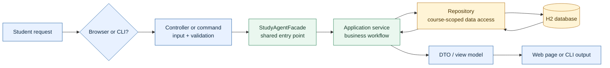
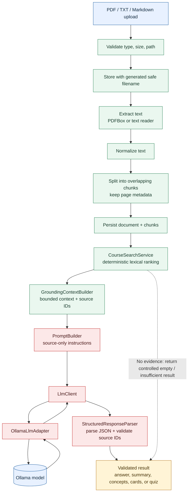

# StudyForge AI Architecture

This diagram is a catch-up view of the implemented StudyForge AI modular monolith. Solid arrows show the main runtime flow; dashed arrows show optional or supporting interactions.

## StudyForge AI Architecture

The original single diagram was too dense to read. This version uses four smaller diagrams. Read them from top to bottom: first the system map, then the main user request flow, then material/AI processing, and finally the agent loop.

## 1. System map

```mermaid
flowchart TB
    User[Student]
    Web[Browser]
    Cli[Picocli CLI]
    Facade[StudyAgentFacade]

    subgraph App[CoursePilot Spring Boot application]
        WebLayer[Web layer\nSpring MVC + Thymeleaf]
        CliLayer[CLI layer\nPicocli commands]
        Services[Application services\nCourses | Materials | Search\nQ&A | Quizzes | Flashcards\nProgress | Plans | Recommendations | History]
        Agent[Agent orchestration\nAnalyze -> Plan -> Validate -> Execute]
        Ai[AI boundary\nLlmClient | PromptBuilder\nStructuredResponseParser]
        Domain[Domain models + repositories]
    end

    Files[(data/uploads\nPDF, TXT, MD)]
    Database[(H2 file database)]
    Ollama[(Optional Ollama\nlocal HTTP API)]

    User --> Web
    User --> Cli
    Web --> WebLayer --> Facade
    Cli --> CliLayer --> Facade
    Facade --> Services
    Facade --> Agent
    Agent --> Services
    Services --> Ai
    Services --> Domain
    Domain --> Database
    Services --> Files
    Ai --> Ollama

    classDef actor fill:#e8f1ff,stroke:#2563a6,color:#102a43
    classDef app fill:#eaf7ef,stroke:#2f855a,color:#173b2b
    classDef store fill:#fff4d6,stroke:#b7791f,color:#4a3200
    classDef external fill:#f3f4f6,stroke:#6b7280,color:#1f2937
    class User,Web,Cli actor
    class WebLayer,CliLayer,Facade,Services,Agent,Ai,Domain app
    class Files,Database store
    class Ollama external
```

**Key idea:** the browser and CLI are two entrances to the same application services. The project is a modular monolith, not a collection of separate microservices.

## 2. Normal request flow

This is the path for course management, material search, quiz submission, flashcard review, progress, plans, and other regular operations.



**Why this matters:** controllers and CLI commands do not duplicate business logic. They translate input, call the facade, and display the result.

## 3. Material and AI flow

This is the important evidence pipeline behind search, grounded Q&A, summaries, concepts, flashcards, quizzes, and wrong-answer explanations.



**Safety boundary:** model output is treated as untrusted data. It must be structured, use supplied source IDs, and pass validation before it becomes an application result or persisted learning content.

## 4. Agent and adaptation loop

The agent does not receive arbitrary system access. It can only execute the registered, course-scoped tools shown below.

```mermaid
flowchart LR
    Request[Agent request]
    Intent[IntentAnalyzer\nunderstand request]
    Plan[TaskPlanner\ncreate observable steps]
    Check[AgentPlanValidator\ncourse scope + max 5 steps]
    Tools[AgentToolManager\nwhitelisted tools]
    Services[Existing services\nsearch | progress | history\nrecommend | summary | cards\nquiz | study plan]
    Memory[MemoryManager\nrecent observable history]
    Response[ResponseSynthesizer]
    Student[Student-facing response]

    Request --> Intent --> Plan --> Check --> Tools --> Services --> Response --> Student
    Memory --> Response
    Services --> Memory

    Quiz[Quiz completed]
    Review[Flashcard reviewed]
    Progress[ProgressService\nweak-topic analysis]
    Recommendation[RecommendationService\nnext action]
    History[LearningHistoryService\nchronological records]

    Quiz --> Progress
    Review --> Progress
    Progress --> Recommendation
    Quiz --> History
    Review --> History
    History --> Memory
    Progress --> Memory

    classDef input fill:#e8f1ff,stroke:#2563a6,color:#102a43
    classDef control fill:#fff4d6,stroke:#b7791f,color:#4a3200
    classDef service fill:#eaf7ef,stroke:#2f855a,color:#173b2b
    classDef event fill:#fce8e8,stroke:#c53030,color:#4a1515
    class Request,Student input
    class Intent,Plan,Check,Tools,Memory,Response control
    class Services,Progress,Recommendation,History service
    class Quiz,Review event
```

**Agent sequence:** understand the request, build a plan, reject unsafe or invalid steps, execute approved tools, combine their results with bounded recent history, and return an observable answer.

## Boundaries to remember

- Authentication and multi-user identity are not implemented in the current release; they are out of scope.
- Ollama is optional. Deterministic course, material, search, grading, progress, planning, and history features remain usable when AI is unavailable.
- OCR, embeddings, vector search, LMS/calendar/email integrations, cloud deployment, and microservices are out of scope.
